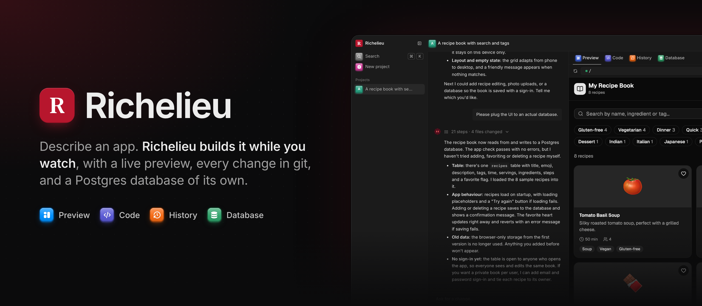
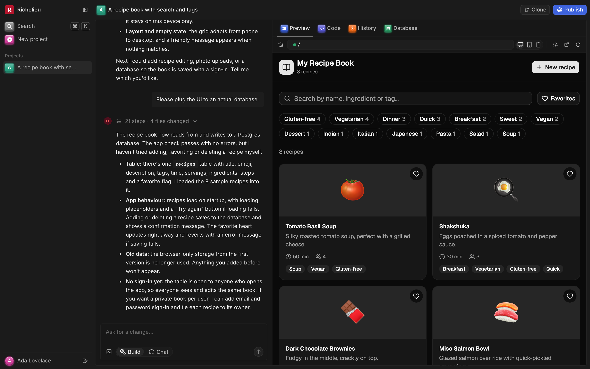
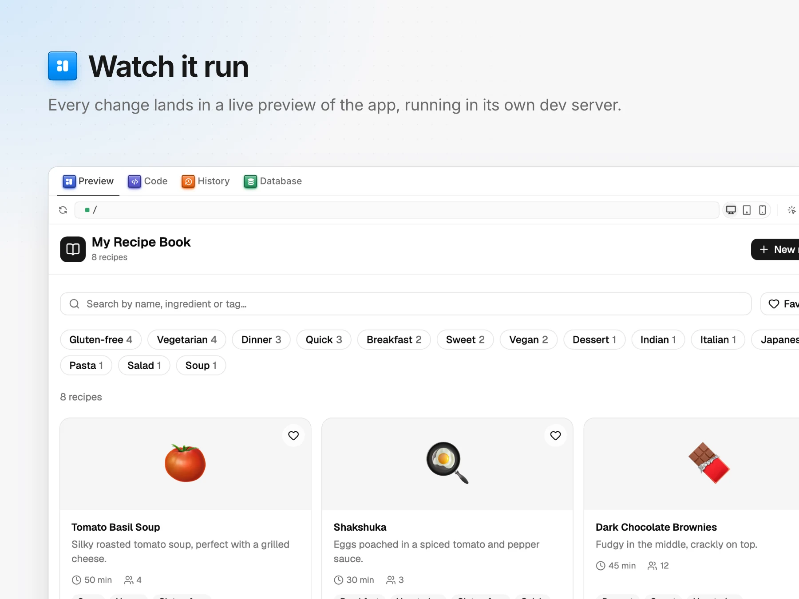
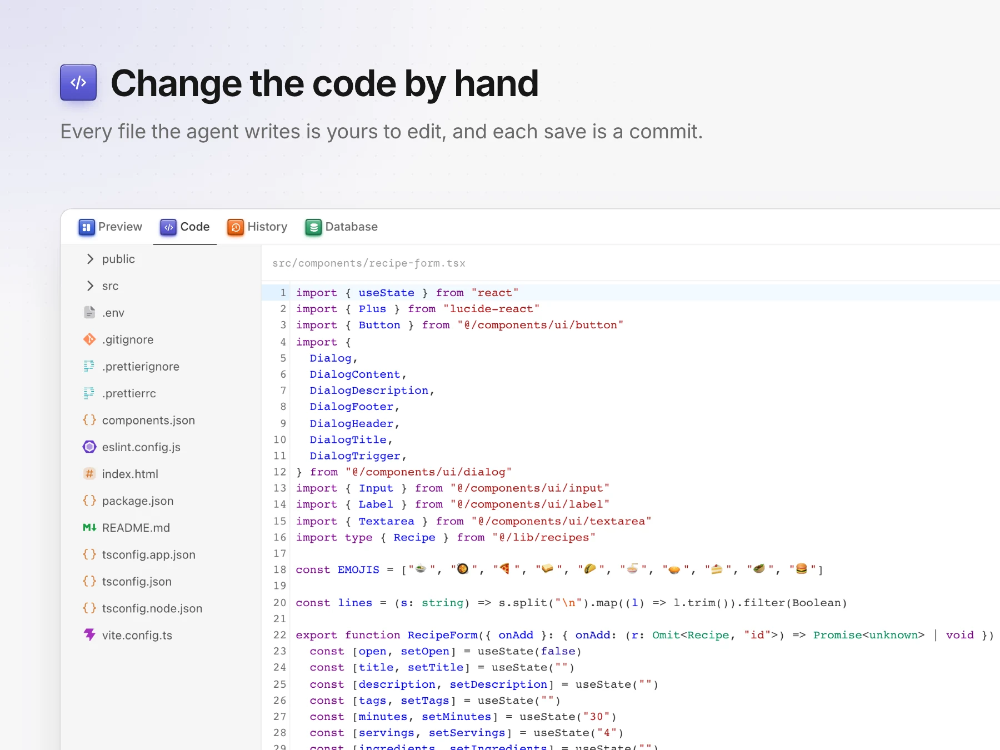
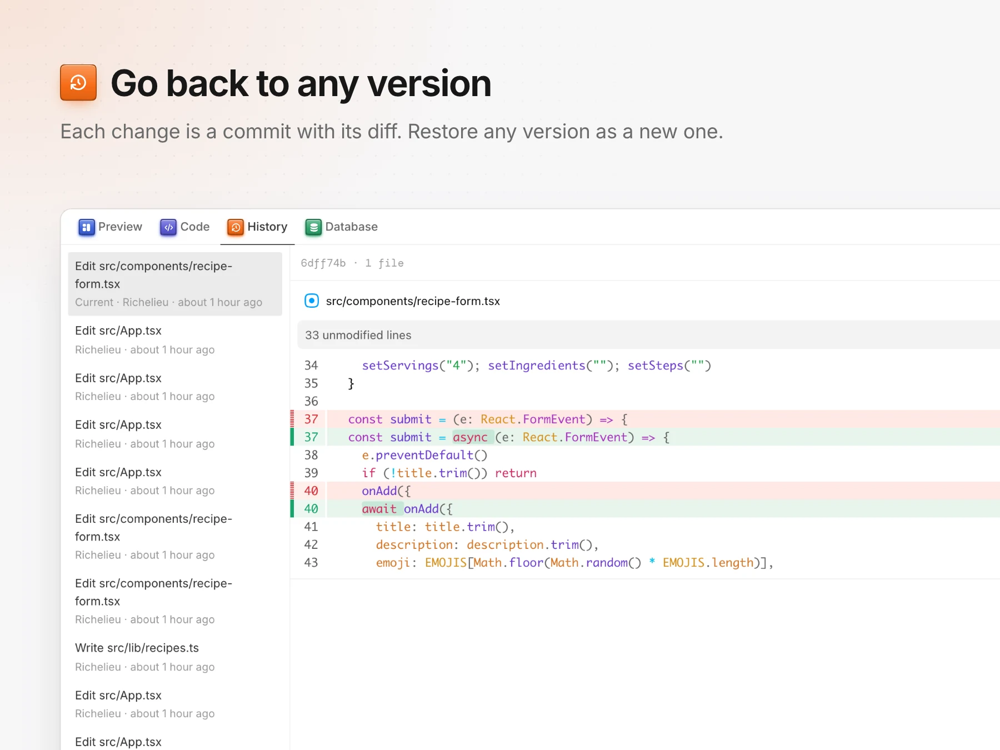
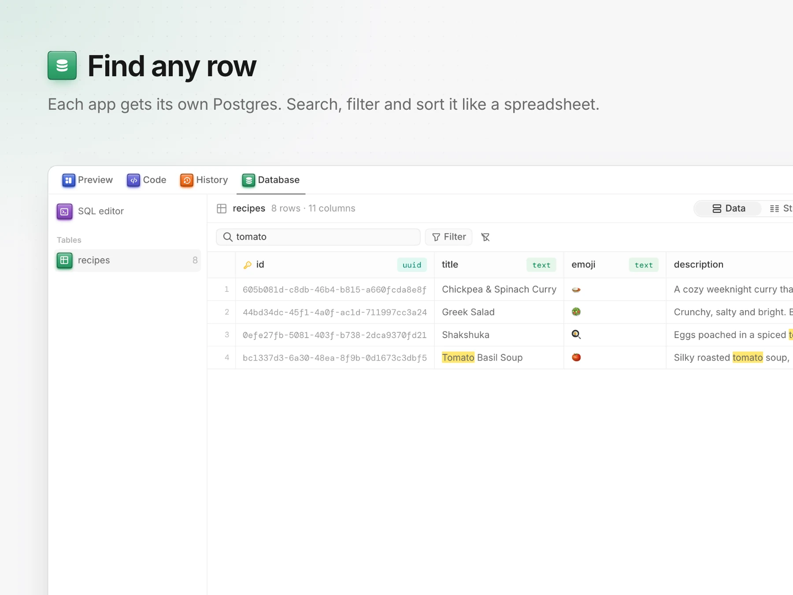
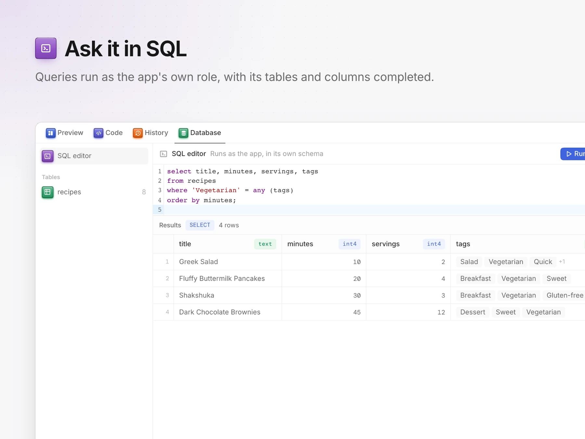
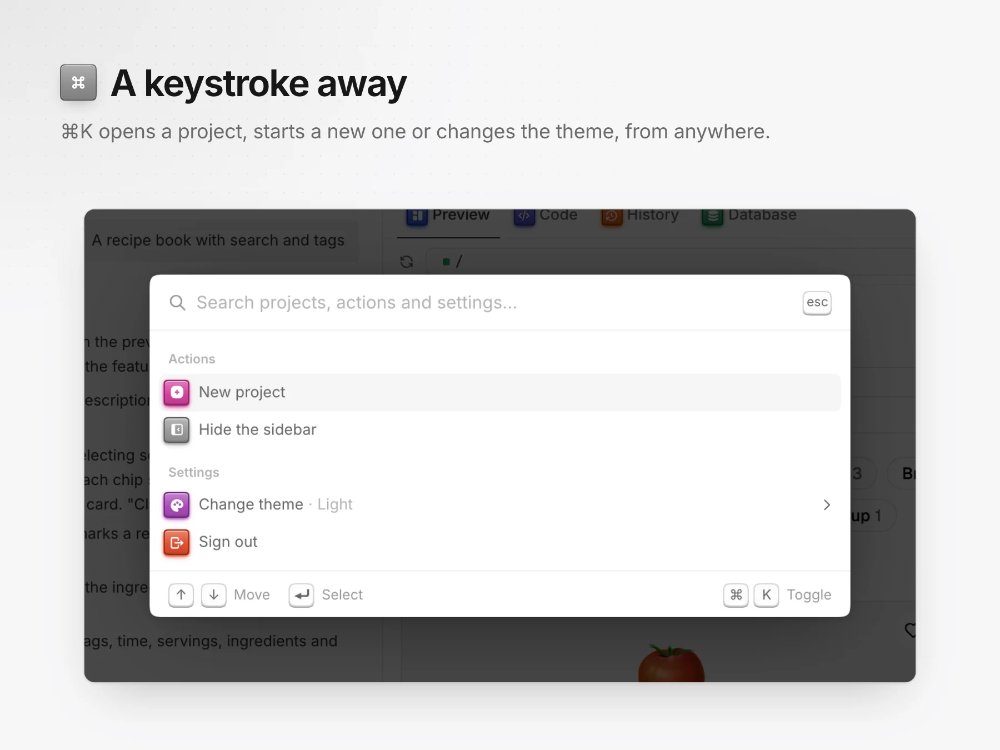

<p align="center">
  
</p>

<h2 align="center">Describe an app. Richelieu builds it while you watch.</h2>

<p align="center">
  <a href="#everything-you-need">Features</a> · <a href="#development">Development</a> · <a href="#the-app-builder">The app builder</a> · <a href="#mail">Mail</a> · <a href="#social">Social</a> · <a href="#newsletter">Newsletter</a>
</p>

<p align="center">
  
</p>

<br />

A Pi Durable agent on Supabase, with its own git forge. Supabase runs locally from `compose.yml`. Everything the app
keeps lives in that one Postgres: the agent's durable state (`pi` schema), the forge's repositories (`forge`
schema), and the app's threads and messages (`public`). The web app talks to Supabase only: Auth, PostgREST and
Realtime.



<br />

## Everything you need

<table align="center">
  <tr>
    <td width="50%">
      <picture>
        <source media="(prefers-color-scheme: dark)" srcset=".github/assets/features/preview-dark.webp" />
        <source media="(prefers-color-scheme: light)" srcset=".github/assets/features/preview-light.webp" />
        
      </picture>
    </td>
    <td width="50%">
      <picture>
        <source media="(prefers-color-scheme: dark)" srcset=".github/assets/features/code-dark.webp" />
        <source media="(prefers-color-scheme: light)" srcset=".github/assets/features/code-light.webp" />
        
      </picture>
    </td>
  </tr>
  <tr>
    <td width="50%">
      <picture>
        <source media="(prefers-color-scheme: dark)" srcset=".github/assets/features/history-dark.webp" />
        <source media="(prefers-color-scheme: light)" srcset=".github/assets/features/history-light.webp" />
        
      </picture>
    </td>
    <td width="50%">
      <picture>
        <source media="(prefers-color-scheme: dark)" srcset=".github/assets/features/database-dark.webp" />
        <source media="(prefers-color-scheme: light)" srcset=".github/assets/features/database-light.webp" />
        
      </picture>
    </td>
  </tr>
  <tr>
    <td width="50%">
      <picture>
        <source media="(prefers-color-scheme: dark)" srcset=".github/assets/features/sql-dark.webp" />
        <source media="(prefers-color-scheme: light)" srcset=".github/assets/features/sql-light.webp" />
        
      </picture>
    </td>
    <td width="50%">
      <picture>
        <source media="(prefers-color-scheme: dark)" srcset=".github/assets/features/command-dark.webp" />
        <source media="(prefers-color-scheme: light)" srcset=".github/assets/features/command-light.webp" />
        
      </picture>
    </td>
  </tr>
</table>

<br />

## Development

```sh
docker compose up -d                    # Supabase: API on :54321, Postgres on :54322, Studio on :54323
bun install
bun run forge:org richelieu --write-env # once: the forge organization the app signs its tokens as
bun dev                                 # app on http://localhost:3000, forge under /forge, sites on :3001
bun test                                # needs Supabase running
```

`.env` needs `ANTHROPIC_API_KEY`. Every other setting has a local default (see `src/config.ts` and `compose.yml`).

How it fits together:

- The app signs users in with the Supabase UI auth forms and writes to `threads` and `messages`, guarded by RLS.
- The agent picks up new user messages. It answers each one with Pi Durable and streams the answer back into
  `messages`, and the app follows it there through Realtime.
- Each thread (a project) has a git repository on the forge, the agent's workspace. Every file the agent writes is a commit.
  `public.files` mirrors each repository's head, and the app shows it with [Pierre](https://pierre.computer)'s
  libraries: `@pierre/trees` for the tree and `@pierre/diffs` for files and their latest change. Code blocks in
  answers also render through `@pierre/diffs`, with `@pierre/theme` and `@pierre/icons` throughout.
- `src/pi/postgres-storage.ts` is Pi Durable's storage on Postgres. It passes the package's storage conformance
  suite. A crash mid-answer resumes on restart.
- Migrations live in `supabase/migrations` and are applied at startup.

## The app builder

Each project is a web app the agent builds while the user watches it run. You describe an app, paste a screenshot
or pick an element of the preview, and the agent changes the code.

- **Template.** A new project starts from `templates/app`: a Vite + React + TypeScript app made by the shadcn CLI,
  with every shadcn/ui component. `bun scripts/app-template.ts` regenerates it.
- **Live preview.** Each open project runs its dev server in a Docker container (`docker/app`), from an image with
  the template's packages already installed. Every commit is copied into it, and the dev server hot-reloads.
  Previews stop after 30 idle minutes. The container has network access, so the agent can add packages
  (`add_dependencies`).
- **The preview talks back.** A dev-server plugin outside the project (`docker/app/richelieu`) tags each JSX
  element with its source location and injects a bridge script. The bridge reports build and runtime errors (the
  agent reads them with `check_app`, and the user can ask it to fix them) and lets the user pick an element to
  change.
- **Agent steps.** The chat shows each tool call as it runs (`messages.steps`). Chat mode
  (`messages.mode = 'chat'`) blocks the tools that change the project.
- **Code and history.** The Code tab edits files by hand: each save is a commit. The History tab lists every
  commit with its diff, and restores any version as a new commit.
- **Publishing.** Publish builds the app with `vite build` in its container and serves it from Postgres
  (`published_files`) on its own origin (`SITES_URL`, by default `http://localhost:3001`). It is never served on
  the builder's origin, where a published app could read the builder's session.
- **Database.** `enable_database` gives an app its own Postgres schema behind the Supabase API (PostgREST reads
  `pgrst.db_schemas` from the database), owned by a login role that reaches only that schema. The agent's
  `run_sql` connects as that role. The app gets `src/lib/supabase.ts` and a `.env`. Its users sign up through
  this project's Supabase Auth, so they share the builder's user pool.
- **Git.** Clone gives a read-only `git clone` URL with a token that expires within the hour.

Previews, `check_app`, `add_dependencies`, `run_command`, publishing and databases need Docker, so they work on
the local server, not in the Vercel functions.

## The forge

`src/forge` is a git forge whose API matches [code.storage](https://code.storage)'s, so the official
`@pierre/storage` SDK works against it unchanged:

```ts
import { GitStorage } from "@pierre/storage";

const store = new GitStorage({
  name: "richelieu", // the organization
  key: process.env.FORGE_PRIVATE_KEY!, // from `bun run forge:org`
  apiBaseUrl: "https://your-app.vercel.app/forge",
  storageBaseUrl: "your-app.vercel.app/forge/git",
});

const repo = await store.createRepo({ id: "my-repo" });
await repo
  .createCommit({
    targetBranch: "main",
    commitMessage: "Initial commit",
    author: { name: "Ada", email: "ada@example.com" },
  })
  .addFileFromString("README.md", "# Hello\n")
  .send();

const url = await repo.getRemoteURL(); // git clone it, push to it
```

What it stores, all in Supabase Postgres: organizations and their public keys, repositories, refs, and git
objects, zlib-compressed and shared across an organization's repositories (forks cost nothing).

What it serves, from one stateless `fetch` handler:

- `/forge/api/v1/*`: repositories (create, fork, find, list, delete), `createCommit`, `createCommitFromDiff`,
  `restoreCommit`, files and file metadata, raw files with ranges and ETags, archives, branches and ephemeral
  branches, tags, commits, blame, commit and branch diffs, merge previews and merges, grep, and notes.
- `/forge/git/<repo>.git`: git's smart HTTP protocol, so `git clone`, `fetch` and `push` work with the URLs from
  `getRemoteURL()` and `getEphemeralRemoteURL()`. A push based on a ref that moved since is refused, as
  git does.

Tokens are ES256 JWTs, the ones the SDK signs: the forge checks them against the organization's public keys
(several during a rotation) and enforces their `repo` and `scopes` claims.

Not supported yet: syncing with GitHub or other remotes (`pullUpstream`, git credentials), shallow and partial
clones, and the `refs` claim's per-ref policies. Merges combine changes line by line; overlapping changes
conflict.

## Mail

Richelieu also runs a mail server for your domains, written in TypeScript: SMTP to receive and send (SPF, DKIM and
DMARC checked on the way in, DKIM-signed on the way out, a retrying queue in Postgres), IMAP for any mail app, and
an inbox in the web app. Mail lives in the same Supabase Postgres. The agent can read, search, draft and send it
through Pi Durable tools, and a mail assistant summarizes new mail and drafts replies.

```sh
sudo bash deploy/vps/install.sh --domain example.com --email you@example.com --anthropic-key sk-ant-...
```

That one command sets up a VPS: Supabase, HTTPS from Let's Encrypt, the agent and the mail server in one
systemd service, and the DNS records to publish. Everything after that can be done from the terminal (`bun run
mail setup`, `doctor`, `dns`, `account`, `password`…) or from **Mail settings** in the browser. See
[docs/mail.md](docs/mail.md).

## Social

Richelieu runs a brand's social media with an agent. It keeps a calendar of drafts and scheduled posts across
LinkedIn, X, Instagram, Threads, Facebook, TikTok, YouTube and Pinterest, and a composer with a preview per platform.
It also shows analytics (follower growth, engagement, the best hours to post) and a watchlist of competitors. Each
brand has a copilot beside its calendar: it learns the brand from its website, plans the week from what worked,
writes drafts in the brand's voice, and studies other accounts. It drafts freely, schedules only when asked, and
never publishes on its own.

Set `ZERNIO_API_KEY` (publishing and analytics, [zernio.com](https://zernio.com)) and `SCRAPECREATORS_API_KEY`
(public accounts, [scrapecreators.com](https://scrapecreators.com)) in `.env`, then open **Social**. See
[docs/social.md](docs/social.md).

## Newsletter

Richelieu runs a Substack newsletter: posts, drafts and scheduling, a Markdown editor with a live preview of what
Substack receives, an ideas backlog, Notes, analytics and a copilot. You can write by hand, let the copilot draft,
or work together: the editor's AI rewrites a selection, writes on from the cursor, turns notes into a draft, proposes
titles and reviews the draft, and each change waits for your Accept. The copilot drafts and revises freely,
schedules only when asked, and never publishes or emails on its own.

Open **Newsletter** and paste your Substack session cookie (`substack.sid`). It is stored encrypted, and only the
server reads it. Set `SUBSTACK_MCP=true` to also give the copilot the tools of
[substack-mcp](https://github.com/marcomoauro/substack-mcp) (subscriber lists, detailed analytics, the reader feed).
See [docs/newsletter.md](docs/newsletter.md).

## Deploying to Vercel and Supabase

1. Create a Supabase project. Migrations apply on the first request, so the database needs nothing else.
2. Create the forge organization against it, and keep the private key:
   `DATABASE_URL=<session pooler URL> bun run forge:org richelieu`.
3. Import the repository in Vercel. `vercel.json` builds the web app with Bun, serves `/forge` and `/api/agent`
   as functions on the Bun runtime, and runs the agent every minute with a cron.
4. Set the environment variables:

   | Variable                            | Value                                                                                             |
   | ----------------------------------- | ------------------------------------------------------------------------------------------------- |
   | `DATABASE_URL`                      | Supabase's session pooler URL (port 5432). The transaction pooler drops the agent's session lock. |
   | `BUN_PUBLIC_SUPABASE_URL`           | `https://<project>.supabase.co`                                                                   |
   | `BUN_PUBLIC_SUPABASE_ANON_KEY`      | The project's anon (publishable) key                                                              |
   | `ANTHROPIC_API_KEY`                 | For the agent                                                                                     |
   | `FORGE_ORG` and `FORGE_PRIVATE_KEY` | From step 2                                                                                       |
   | `PUBLIC_URL`                        | Optional; the app's URL, for git remote URLs. Defaults to the production domain.                  |

5. In Supabase Auth, set the site URL to the Vercel domain.

When deployed, the agent is a function. The app wakes it after each message, and the cron catches anything left
over. Pi Durable's writer lock keeps runs one at a time. An answer that outlives a run resumes in the next one.

Vercel caps request bodies at 4.5 MB, which limits the size of a single `git push` or `createCommit`. `bun run
build && bun run preview` serves the production build locally, routed like `vercel.json`.

## License

This project is licensed under the [MIT License](LICENSE).
